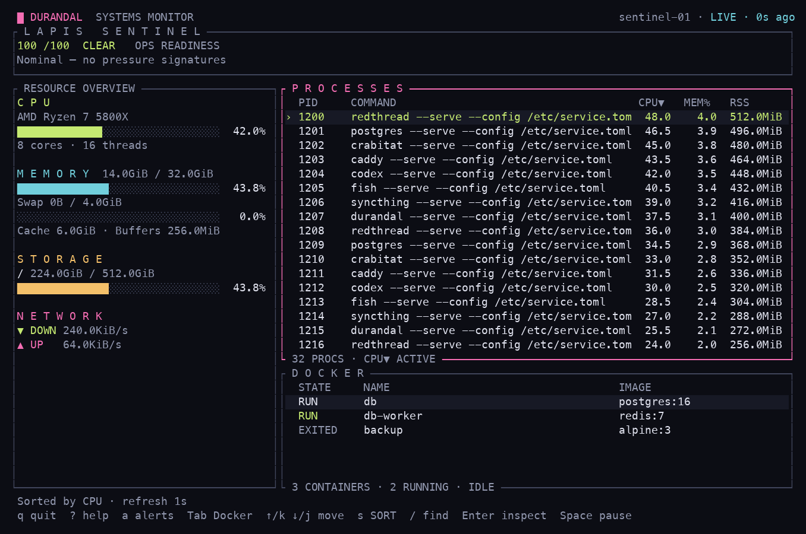
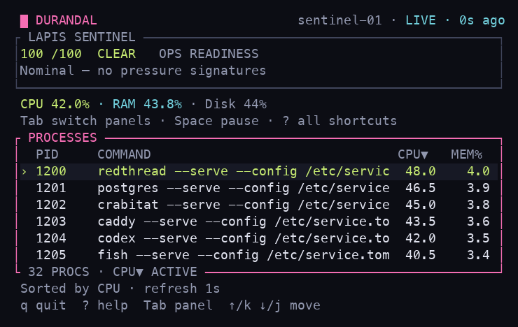

# Durandal RS

[](https://github.com/Blumenwagen/durandal-rs/actions/workflows/ci.yml)

Rust rewrite of [Durandal](https://github.com/Blumenwagen/durandal): a Linux terminal system monitor with the same brutalist, magenta-tinted visual identity, plus agent-readable ops snapshots for scripts, dashboards, and autonomous maintenance loops.

Durandal RS is kept in its own repository so the original Go implementation can stay stable while the Rust port grows toward feature parity.

## Dashboard



The dashboard keeps Durandal's magenta, lime, and cyan identity with quieter borders,
clear panel focus, and more space for process rows. At 100 columns and 24 rows or
larger, resources sit beside the process and Docker tables. Smaller terminals show
a compact resource summary and one focused table; `Tab` switches between processes
and containers. Below 50 × 12, the app asks for more space while keeping quit available.



These images render deterministic demo values through the actual Ratatui widgets;
they are not measurements from a running Linux machine. The renderer is reproducible:

```sh
cargo run --example dashboard
cargo run --example dashboard -- --width 64 --height 18
cargo run --example dashboard -- --mode inspector
```

The example also supports `docker`, `search`, `help`, `alerts`, `confirm`, and
`offline` modes, and `--cells` exports the rendered cell colors and text as JSON.

## Current scope

Linux TUI monitor, Sentinel health signals, JSON snapshots, Prometheus/OpenMetrics
output, and health-check exit codes. The Go implementation remains separate.

- Collection runs on a worker so slow telemetry or Docker queries do not block navigation.
- Process CPU and aggregate non-loopback network rates use real interval counters
  in the TUI. The first sample is a baseline, shown as unavailable rather than zero.
  A newly observed process needs its own baseline; its CPU starts at zero.
- Process selection follows the PID and container selection follows the container ID
  across refreshes, with stable PID ordering for equal sort values.
- Pause freezes the displayed snapshot. Destructive actions require resuming first,
  then a confirmation dialog with a captured target. `K` sends SIGTERM, not SIGKILL.
- The inspector retains the full command line and can scroll. GPU discovery is shown
  without inventing utilization or temperature readings; GPU sensors remain unimplemented.
- Interval sampling applies to the TUI. One-shot JSON/Prometheus output retains its
  schema and does not gain interval measurements.

## What works now

- `agent`, `snapshot`, and `json` commands emit versioned `durandal.agent.v1` JSON.
- `prometheus` emits scrape-ready OpenMetrics-style text for the current snapshot.
- `check` prints a compact Sentinel health line and exits with status-shaped codes.
- The Ratatui/Crossterm TUI renders:
  - `LAPIS SENTINEL` ops-readiness score and alert strip
  - CPU, memory, swap, network, storage, and process panels
  - Docker inventory panel when Docker is available
  - Go Durandal-inspired block/rule styling and control hints
- Docker collection is read-only by default at collection time (`docker ps -a --format '{{json .}}'`).
- Docker action helpers require explicit confirmation before producing a `docker start|stop|restart` plan.

## Install / run locally

Requirements:

- Linux
- Rust 1.88 or later (Edition 2024 and let-chain support)
- Docker CLI is optional; Durandal RS still runs when Docker is missing or unavailable.

```bash
git clone https://github.com/Blumenwagen/durandal-rs.git
cd durandal-rs
cargo run
```

Build an optimized binary:

```bash
cargo build --release
./target/release/durandal-rs --help
```

## CLI usage

```bash
# Launch the interactive TUI.
cargo run

# Compact one-shot JSON payload for agents, scripts, cron jobs, or dashboards.
cargo run -- agent --json --pretty --top 8

# Aliases for the same JSON snapshot shape.
cargo run -- snapshot --pretty --top 8
cargo run -- json --pretty --top 8

# Prometheus/OpenMetrics scrape text.
cargo run -- prometheus --top 5

# Human-readable health check.
# Exit code: 0 clear/below threshold, 1 WATCH, 2 WARN, 3 CRIT.
cargo run -- check --fail-on warn

# Full JSON payload while preserving health-check exit semantics.
cargo run -- check --json --pretty --fail-on crit
```

`check --fail-on` accepts `watch`, `warn` / `warning`, `crit` / `critical`, or numeric aliases `1`-`3`.

## Agent JSON schema

Durandal RS emits schema `durandal.agent.v1`.

Top-level fields:

- `schema` and `generated_at`
- `host`: hostname, user, OS, kernel, architecture, uptime
- `health`: Sentinel score, status, alerts, recommendations
- `resources`: CPU, memory, swap, network, disks, optional GPUs
- `top_processes`: bounded process list, controlled by `--top`
- `docker`: availability, counts, and container summaries
- `agent_short_text`: compact human-readable summary for logs or chat alerts

Example shape:

```json
{
  "schema": "durandal.agent.v1",
  "health": {
    "score": 100,
    "status": "CLEAR",
    "alerts": [
      {
        "severity": "info",
        "label": "OK",
        "message": "Nominal — no pressure signatures"
      }
    ]
  },
  "agent_short_text": "CLEAR score 100 · CPU 0% · RAM 32% · disk / 72% · docker 4/5 running · top alert: Nominal — no pressure signatures"
}
```

## Prometheus / OpenMetrics output

`durandal-rs prometheus` includes core gauges such as:

- `durandal_health_score`
- `durandal_cpu_usage_percent`
- `durandal_memory_usage_percent`
- `durandal_swap_usage_percent`
- `durandal_network_recv_bytes_per_second`
- `durandal_network_sent_bytes_per_second`
- `durandal_docker_available`
- `durandal_docker_containers_total`
- `durandal_docker_containers_running`
- `durandal_docker_containers_stopped`

Use `--top N` to cap process-cardinality surfaces where applicable.

## TUI controls

| Key | Action |
| --- | --- |
| `Tab`, `Shift+Tab`, `c` | Switch between process and Docker panels |
| `↑`/`k`, `↓`/`j` | Move selection |
| `PageUp`, `PageDown` | Move one visible table page; scroll an open inspector/help dialog |
| `Home`, `End` | Select the first/last row |
| `s` | Switch CPU/memory sorting in the process panel |
| `/` | Edit a process filter by name, command, or PID |
| `Enter` / `Esc` during search | Apply / cancel edits (cancel restores the previous filter) |
| `Enter` | Open/close the selected process inspector |
| `Esc` | Close inspector, clear an applied search, or return to processes |
| `a` | Inspect Sentinel health signals; `↑`/`↓` scroll, `Esc` closes |
| `Space` | Pause/resume displayed telemetry |
| `?`, `F1` | Show keyboard help; `↑`/`↓` and page keys scroll |
| `K` | Request SIGTERM for the selected process; confirm with `Y`, cancel with `N`/`Esc` |
| `x` / `r` | Start/stop or restart a selected container; confirmation required |
| `d` | Toggle dimmed colors |
| `q` | Quit; closes help or cancels a confirmation first |
| `Ctrl+C` | Quit from any input mode |

Docker inventory collection is read-only (`docker ps -a`). Docker controls are
available by default and honor `Config` when embedding the TUI; configuration-file
discovery is still a roadmap item. Actions never run merely by opening a dialog.
Terminal raw mode and the alternate screen are restored on normal exit and errors.

## Development / quality gates

```bash
cargo fmt -- --check
cargo test
cargo clippy --all-targets --all-features -- -D warnings
cargo build --release
```

The CI workflow runs the same formatting, lint, and test gates on GitHub.

## Repository layout

- `src/metrics.rs`: host, resource, process, Docker, and GPU snapshot collection
- `src/ops.rs`: Sentinel score/status/alert evaluation
- `src/agent.rs`: JSON and Prometheus serialization
- `src/tui.rs`: TUI interaction state and background collection
- `src/tui/view.rs`: adaptive Ratatui widgets and dialogs
- `src/metrics/live.rs`: interval CPU/network sampling
- `examples/dashboard.rs`: deterministic native-widget previews
- `src/docker.rs`: Docker collection and gated action planning
- `tests/`: CLI, Sentinel, parity, and next-phase behavior tests

## Roadmap

- Add configuration-file discovery and documentation once config loading is user-facing.
- Expand parity tests against snapshots from Go Durandal.
- Add sampled CPU history and measured GPU sensor support.
- Package release artifacts after the first repository push and CI pass.

## License

MIT. See [LICENSE](LICENSE).
